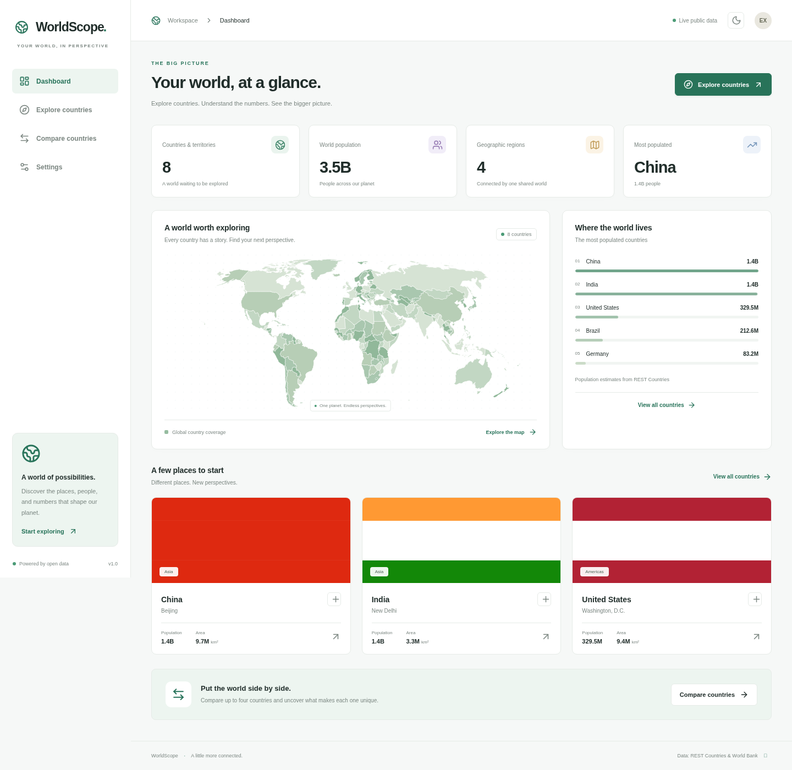
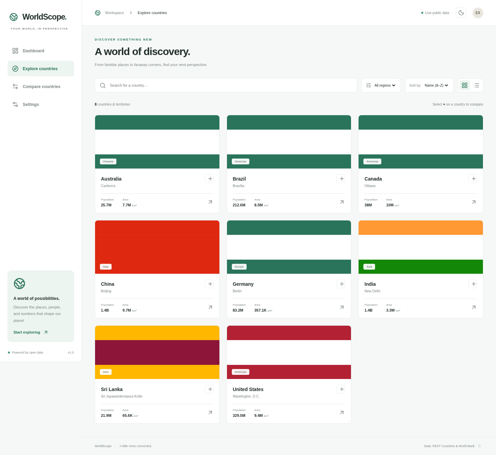
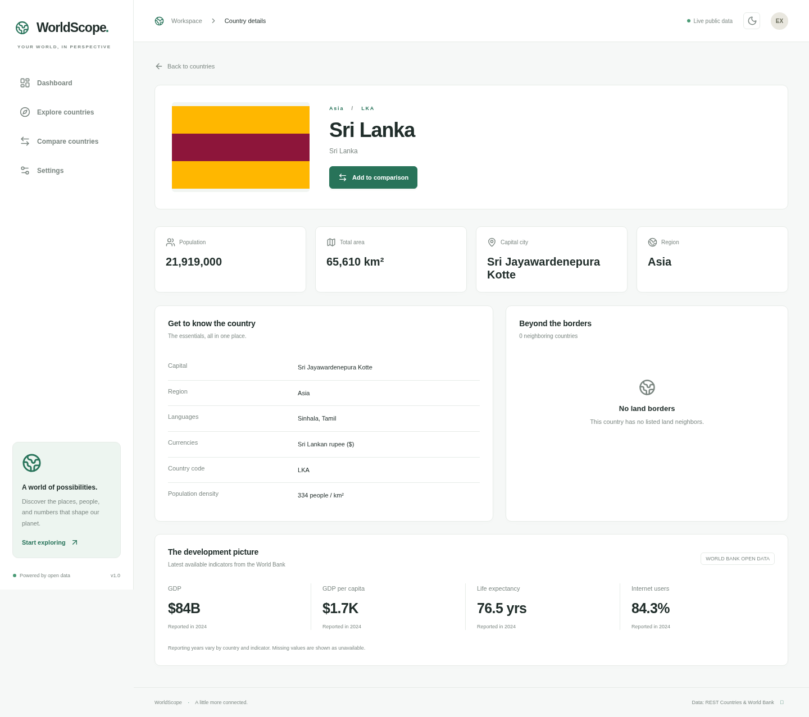
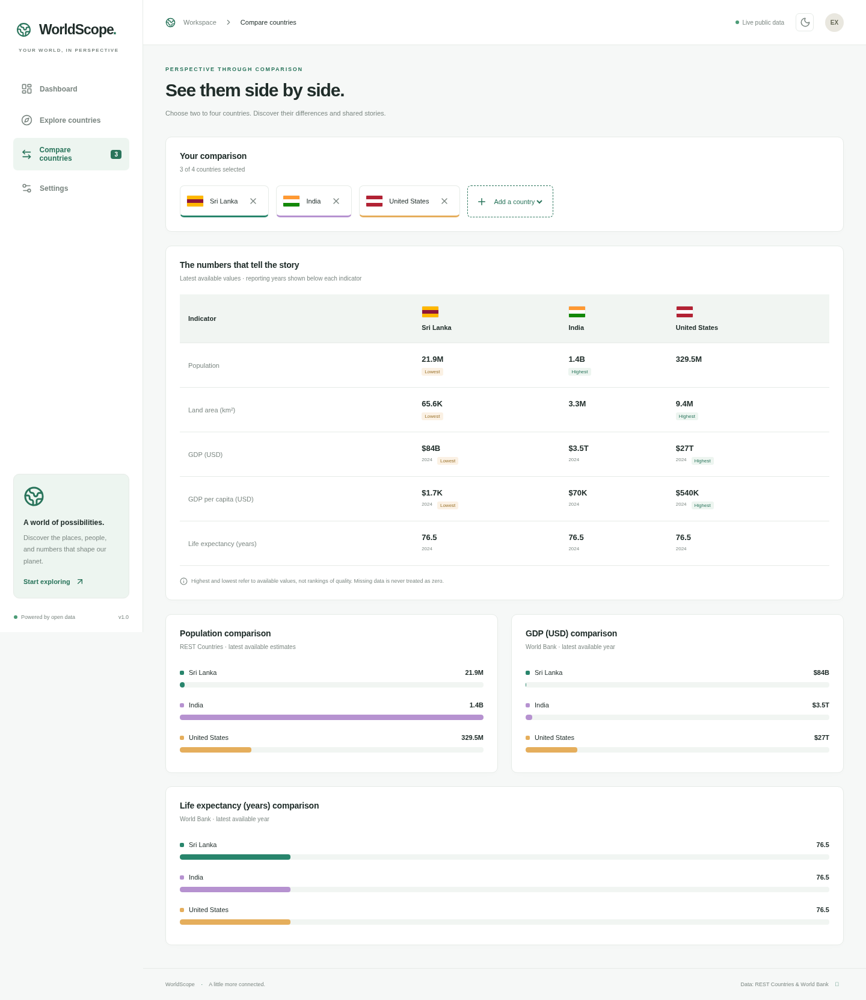
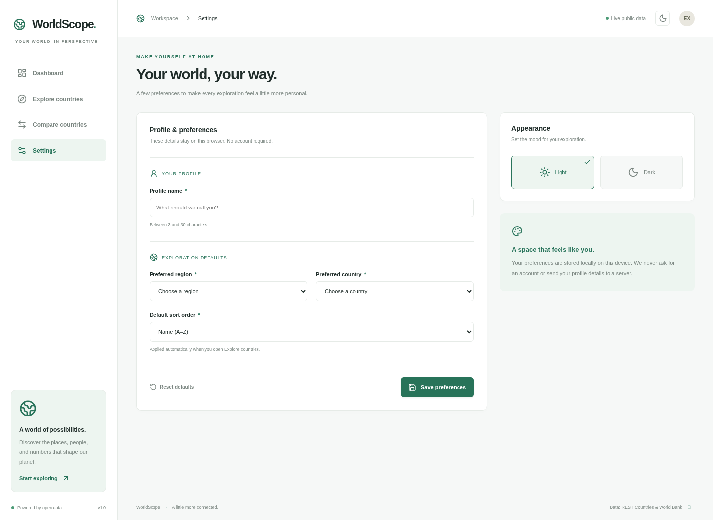
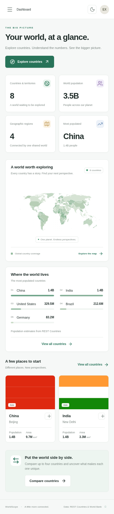

# WorldScope

A responsive global country intelligence dashboard built with **React, Vite, JavaScript, and React Router** for the WorldScope practical assessment.

**Repository:** https://github.com/nethsara-rahiru/REACT-PRACTICAL-ASSESSMENT

## Run locally

Requires Node.js **22.12+** (or Node.js 24 LTS) and npm. Validated with Node.js 24.19.0.

```bash
npm install
npm run dev
```

For a reproducible installation, use `npm ci` instead of `npm install`. Open the address printed by Vite. No account, API keys, database, or `.env` file is required.

```bash
npm run build       # Production output in dist/
npm run preview     # Serve the production build locally
npm run lint        # Static checks
npm run format      # Format source, tests, and configuration
```

For a hosted deployment, serve `dist/` and configure your host to rewrite non-file requests to `index.html`, so direct country URLs and other React Router routes work on refresh.

## Features

- **Dashboard:** fetched country/territory count, aggregate population, geographic regions, most populated country, world map, population ranking, and country highlights. A saved preferred country appears first in highlights.
- **Explore:** country-name search, region filtering, name/population/area sorting, grid and list views, URL search parameters, and incremental loading of cards.
- **Country details:** dynamic `/country/:code` routes, flags, capital, population, area, languages, currencies, density, and links to neighboring countries.
- **Development indicators:** latest non-null GDP, GDP per capita, life expectancy, and internet-use observations, with individual reporting years.
- **Compare:** select and remove two to four distinct countries. View a table and three horizontal bar charts (population, GDP, life expectancy), with highest/lowest available values marked in the table. One selection is allowed while building a comparison; results begin at two.
- **Settings:** controlled profile name, preferred region/country, and default sort. Field-specific validation, browser persistence, and confirmed reset. No profile information is sent to a server.
- **Appearance:** persistent light/dark themes, responsive navigation and layouts, accessible control labels, keyboard focus indicators, and reduced-motion support.
- **Resilience:** loading, empty, unavailable, and retry states; request cancellation, a 20-second request timeout, and protection against stale indicator responses. Individual failed World Bank indicators do not discard successful results.
- **404:** a useful recovery route for unknown paths and invalid country codes.

## Routes

| Route               | View                            |
| ------------------- | ------------------------------- |
| `/`                 | Dashboard                       |
| `/explore`          | Country explorer                |
| `/country/LKA`      | Example country profile         |
| `/compare`          | Country comparison              |
| `/settings`         | Profile, preferences, and theme |
| Any unmatched route | Not Found                       |

## Data sources and meaning

**REST Countries** — `https://restcountries.com/v3.1/all?fields=name,cca3,capital,population,area,region,flags,languages,currencies,borders`

The request uses ten fields to respect the API field limit. Country flags are loaded from the URLs returned by the service (normally `flagcdn.com`). Country count includes territories; population is the sum of available API estimates and is not a same-year world census. The API's `area` field is total surface area, used as the assessment's area comparison; it is not a separate World Bank land-only measure.

**World Bank Open Data** — `https://api.worldbank.org/v2/country/{ISO3}/indicator/{indicator}?format=json&per_page=30`

| Indicator                                       | World Bank code  |
| ----------------------------------------------- | ---------------- |
| GDP, current USD                                | `NY.GDP.MKTP.CD` |
| GDP per capita, current USD                     | `NY.GDP.PCAP.CD` |
| Life expectancy at birth, years                 | `SP.DYN.LE00.IN` |
| Individuals using the Internet, % of population | `IT.NET.USER.ZS` |

The app searches the latest 30 returned observations for the newest numeric value. Missing observations remain **Unavailable**, never zero. Reporting years differ between countries and measures. World Bank coverage does not include every REST Countries territory. Comparisons use nominal current USD and do not adjust for purchasing power or different reporting years.

The geographic backdrop uses **world-atlas / Natural Earth** data and is bundled locally. Shading is decorative, not a statistical choropleth. Hover identifies map countries; the Explore links open the country explorer.

## Architecture and decisions

```text
src/
  components/     Shared layout, country cards, map, UI states, indicator hook
  context/        App provider, context hook, preference defaults
  pages/          Dashboard, Explore, CountryDetails, Compare, Settings, NotFound
  services/       Reusable fetch and public API functions
  utils/          Number formatting, sorting, region definitions
```

- React Context shares the country dataset, comparison selections, preferences, and theme without duplicating fetches on every route.
- Local component state handles short-lived inputs and UI controls. The explorer stores its filter values in the URL. Comparison selections last for the current app session.
- `AbortController` cancels obsolete requests on unmount or country changes. The indicator hook associates results with the requested country codes and retry attempt before rendering them.
- World Bank requests run independently with `Promise.allSettled`; successful complete country results are cached in memory. Retrying partial failures requests the indicators again.
- `localStorage` persists preferences and theme. Reads tolerate invalid JSON, and failed writes are reported instead of claiming a successful save. Reset clears profile/exploration preferences; appearance is controlled separately.
- Custom CSS and SVG charts keep the interface consistent and avoid a large charting dependency. Chart values also appear in the semantic comparison table.

## Automated verification

```bash
npx playwright install chromium
npm test
```

If you already have a system Chromium, you can select it explicitly:

```bash
PLAYWRIGHT_CHROMIUM_PATH=/usr/bin/chromium npm test
```

The Playwright suite starts Vite automatically (or reuses an existing local development server). It uses deterministic, intercepted API responses. Tests cover dashboard summaries, search/filter/sort/list modes, details and neighbor routing, missing comparison values, selection limits, preferences and reset, themes, mobile/tablet layout, API failure/retry, partial indicator failures, rapid navigation, and 404 routing. **These tests verify app behavior, not live API availability.**

For a live smoke test, run the app with unrestricted access to its required public API domains, then verify that countries load and `/country/LKA` displays reporting years from the World Bank. For details and comparison, test both covered countries and territories with missing indicators.

## Screenshots and demonstration

[Demonstration guide](docs/DEMONSTRATION.md) contains a walkthrough and the React/API/state decisions to explain.

Screenshots in [`docs/screenshots/`](docs/screenshots/) cover every major page plus mobile and dark mode. **They are UI captures using deterministic test fixtures and simplified test flags, not live-data evidence.** The running application always requests the real APIs and never imports fixture data. Regenerate with Vite running:

```bash
npm run dev
# In another terminal:
node scripts/capture-screenshots.mjs
# Or use PLAYWRIGHT_CHROMIUM_PATH=/usr/bin/chromium with the command above.
```

| Dashboard                                                   | Explorer                                                 |
| ----------------------------------------------------------- | -------------------------------------------------------- |
|  |  |

| Country profile                                                         | Compare                                                    |
| ----------------------------------------------------------------------- | ---------------------------------------------------------- |
|  |  |

| Settings                                   | Mobile                                                          |
| ------------------------------------------ | --------------------------------------------------------------- |
|  |  |

## Cloud environment validation limitation

During development, the cloud egress policy denied `restcountries.com` and `api.worldbank.org` with HTTP 403 before requests reached the services. Required domains (`restcountries.com`, `api.worldbank.org`, `flagcdn.com`) have been added to the cloud environment configuration draft. Review and save the changes in environment settings, then publish the environment. Live API availability and cross-origin behavior still require verification after access is applied. No API data has been fabricated or substituted in the application.

## AI-use declaration

OpenAI Codex assisted with project scaffolding, UI implementation, API integration, documentation, and automated tests. The student must review, understand, and be able to explain and demonstrate the submitted code, as required by the assessment. AI assistance does not substitute for a live demonstration or verification of external data.
